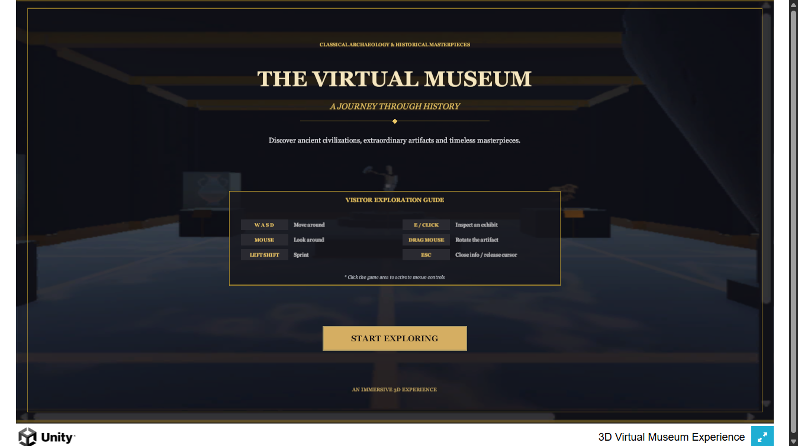
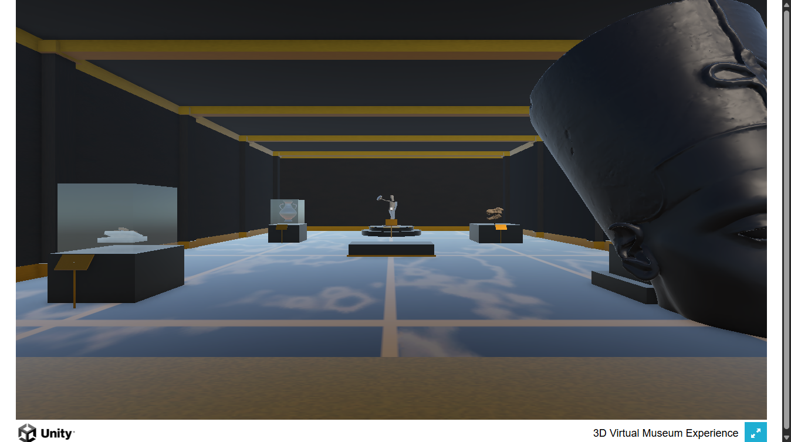

# The Virtual Museum — 3D Web Experience

An immersive, interactive 3D Virtual Museum running directly in modern web browsers via Unity 6 Universal Render Pipeline (URP) WebGL.

**Live Website:** [https://christopher-marian.github.io/virtual-museum/](https://christopher-marian.github.io/virtual-museum/)

---

## Preview

| Welcome Screen & Visitor Guide | Museum Hall & Exhibits |
| :---: | :---: |
|  |  |

---

## Exploration Controls

| Key / Input | Action |
| :--- | :--- |
| **W A S D** | Walk forward, left, backward, right |
| **Mouse** | Look around (first-person camera) |
| **Left Shift** | Sprint / accelerate movement |
| **E / Left Click** | Inspect exhibit & view curatorial history |
| **Mouse Drag** | Rotate 3D artifact on turntable during inspection |
| **ESC** | Close inspection panel / toggle cursor lock |

> **Note:** Click anywhere inside the browser window to capture mouse controls.

---

## Featured Exhibits

1. **Ancient Greek & Roman Coins** — Vitrine display with classical gold patina and historical markings.
2. **Attic Black-Figure Amphora** — Terracotta ancient Greek pottery with mythological motifs in a dedicated glass display case.
3. **Tyrannosaurus Rex Fossil Skull** — Late Cretaceous fossil mounted on an articulated bronze armature.
4. **Bust of Queen Nefertiti** — 18th Dynasty Amarna royal portrait sculpture on an obsidian plinth.
5. **The Discobolus of Myron** — High Classical Greek discus thrower elevated on the grand central rotunda platform.

---

## Architecture & Tech Stack

- **Engine:** Unity 6 (6000.5.6f1) Universal Render Pipeline (URP)
- **Target:** WebGL (WASM + WebGPU/WebGL 2.0)
- **Audio:** Spatial audio with WebAudio context management
- **Deployment:** GitHub Pages via GitHub Actions
